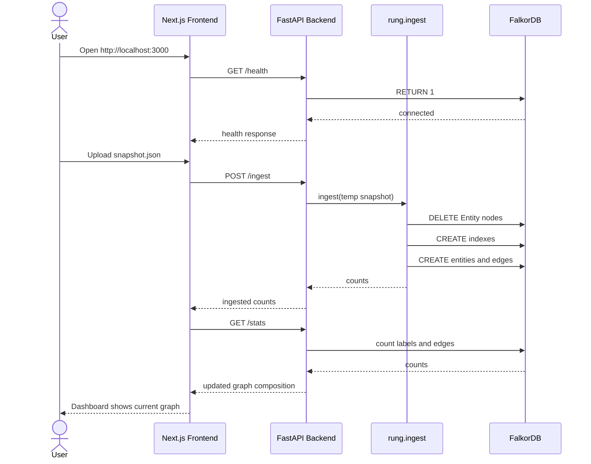

# Rung — End-to-End Application Workflow

This document explains how to run Rung and use it end to end, from starting the stack to ingesting a Kubernetes snapshot and viewing the resulting graph.

---

## 1. What Rung Does

Rung converts a sanitized Kubernetes snapshot into a graph in FalkorDB.

The workflow is:

1. A user provides `snapshot.json`.
2. The backend ingests the snapshot.
3. Entities and structural relationships are created in FalkorDB.
4. The frontend displays graph health, connectivity, and composition counts.

---

## 2. Prerequisites

Required:

- Docker
- Docker Compose

Optional for local development:

- Python 3.12+
- Node.js 22+
- npm

---

## 3. Quick Start with Docker

From the project root:

```bash
docker compose up -d --build
```

This starts:

| Service | URL | Purpose |
|---|---|---|
| Frontend | http://localhost:3000 | Dashboard UI |
| Backend API | http://localhost:8000 | REST API |
| FalkorDB | localhost:6380 | Graph database |
| FalkorDB Browser | http://localhost:3100 | Database browser |

Check backend health:

```bash
curl http://localhost:8000/health
```

Expected response:

```json
{
  "status": "ok",
  "falkordb": "connected",
  "graph": "rung:kind-graphhacks"
}
```

---

## 4. Using the Web Application

Open:

```text
http://localhost:3000
```

You will see:

- a FalkorDB connection badge
- a Refresh button
- a snapshot upload form
- graph composition cards

### Upload and Ingest a Snapshot

1. Click **Choose file**.
2. Select a JSON snapshot, for example:
   - `dataset/sample-10.json`
   - `dataset/sample-attack-chain.json`
   - `dataset/sample-secure.json`
3. Click **Upload & ingest**.
4. Wait for the success message.
5. The graph composition cards update with counts.

Example expected result for `dataset/sample-10.json`:

```json
{
  "Pod": 2,
  "Container": 2,
  "Identity": 2,
  "PermSet": 1,
  "Volume": 1,
  "Node": 1,
  "Cluster": 1,
  "Entity": 10
}
```

---

## 5. Using the API Directly

### Check health

```bash
curl http://localhost:8000/health
```

### Get graph stats

```bash
curl http://localhost:8000/stats
```

### Ingest a snapshot

```bash
curl -F file=@dataset/sample-attack-chain.json http://localhost:8000/ingest
```

Expected response shape:

```json
{
  "status": "ingested",
  "counts": {
    "Pod": 1,
    "Container": 1,
    "Identity": 1,
    "PermSet": 1,
    "Volume": 1,
    "Node": 1,
    "Cluster": 1,
    "Entity": 7
  }
}
```

---

## 6. Running with Launcher Scripts

Backend:

```bash
./scripts/run-backend.sh
```

Frontend:

```bash
./scripts/run-frontend.sh
```

These scripts:

- build the required Docker images
- start the services detached
- print the local access URLs

---

## 7. Local Development Workflow

### Backend

```bash
cd backend
python -m venv .venv
source .venv/bin/activate
pip install -r requirements.txt
PYTHONPATH=. uvicorn app.main:app --reload --port 8000
```

### Frontend

```bash
cd frontend
npm install
NEXT_PUBLIC_API_URL=http://localhost:8000 npm run dev
```

Then open:

```text
http://localhost:3000
```

---

## 8. Testing Workflow

Run backend tests:

```bash
cd backend
PYTHONPATH=. pytest -q
```

Expected:

```text
4 passed
```

Validate all datasets:

```bash
cd backend
for f in ../dataset/*.json; do
  PYTHONPATH=. \
  FALKORDB_HOST=localhost \
  FALKORDB_PORT=6380 \
  FALKORDB_GRAPH="rung:$(basename "$f" .json)" \
  python -c "from rung.ingest import ingest; print('$f', ingest('$f', stats=False)['Entity'])"
done
```

---

## 9. Sample Datasets

| Dataset | Use |
|---|---|
| `dataset/sample-empty.json` | Empty snapshot edge case |
| `dataset/sample-small.json` | Small non-admin workload |
| `dataset/sample-10.json` | Balanced demo input |
| `dataset/sample-secure.json` | Restricted, low-risk case |
| `dataset/sample-attack-chain.json` | High-risk escalation chain |
| `dataset/sample-scale.json` | Load/performance testing |

---

## 10. How the End-to-End Flow Works



---

## 11. Troubleshooting

### Backend not reachable

```bash
curl http://localhost:8000/health
```

If it fails, inspect logs:

```bash
docker compose logs backend
```

### FalkorDB disconnected

Inspect database logs:

```bash
docker compose logs falkordb
```

Restart the stack:

```bash
docker compose down
docker compose up -d --build
```

### Frontend shows empty graph

Ingest a dataset:

```bash
curl -F file=@dataset/sample-10.json http://localhost:8000/ingest
```

Then refresh the dashboard.

### Port already in use

Stop old processes or containers:

```bash
docker compose down
```

---

## 12. Stopping the Application

```bash
docker compose down
```

This stops and removes the FalkorDB, backend, and frontend containers.

---

## 13. Summary

Rung's complete workflow is:

1. Start the Docker stack.
2. Upload or ingest a Kubernetes snapshot.
3. Tear down old entity nodes.
4. Create entities, edges, and indexes.
5. Query graph counts.
6. View the result in the browser dashboard.
EOF
echo written