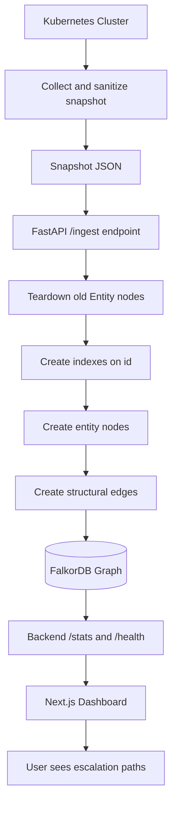
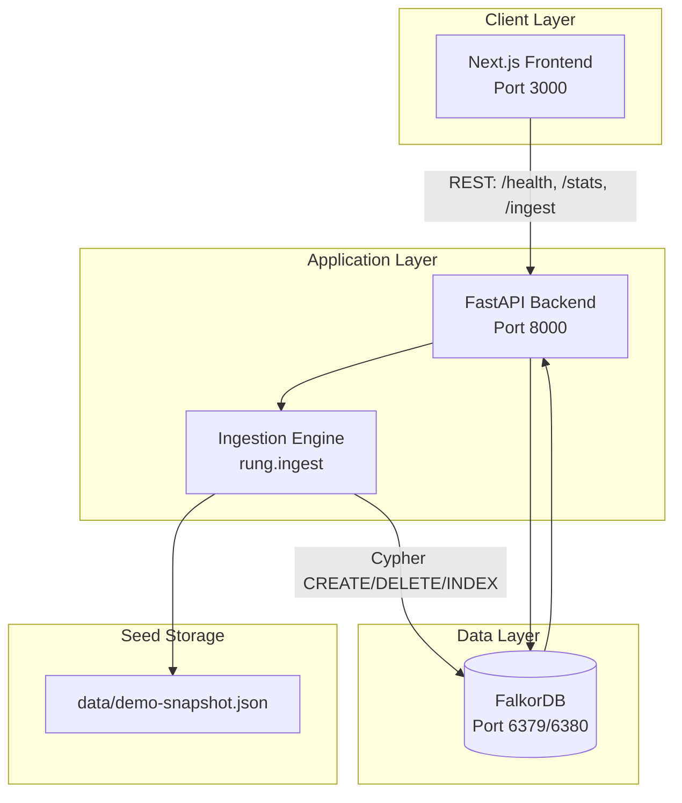
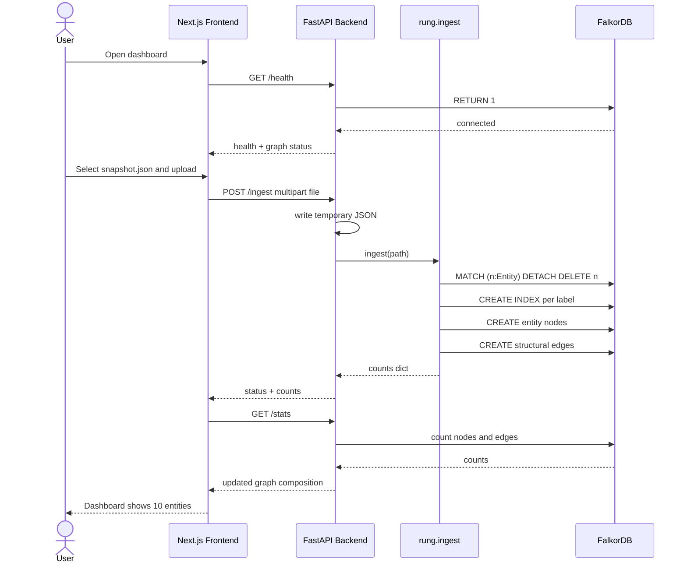
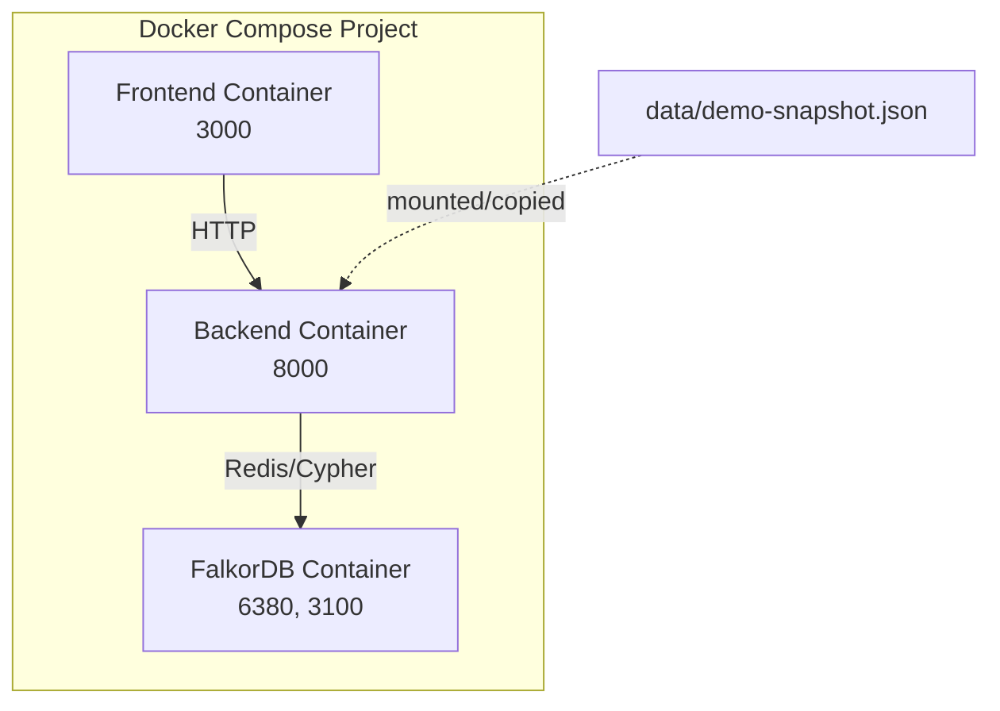

# Rung — Technical Documentation

## 1. Executive Summary

Rung is a graph-backed security analysis tool for Kubernetes privilege escalation. It converts a sanitized Kubernetes cluster snapshot into a traversable property graph in FalkorDB and exposes the resulting graph to a modern Next.js frontend and FastAPI backend.

The core idea is to model **reachable attack preconditions**, not just static RBAC permissions. Many existing tools model permissions as direct capabilities and therefore over-report. Rung instead creates structural graph entities (pods, containers, identities, permission sets, volumes, nodes, cluster) and marks only precondition-satisfying paths as walkable (`attack_path = 1`). This makes escalation chains visible, inspectable, and easy to reason about through a browser UI.

This project currently provides a Dockerized full-stack implementation:

- **Frontend:** Next.js + TypeScript + Tailwind CSS
- **Backend:** FastAPI + Python
- **Graph database:** FalkorDB
- **Ingestion engine:** `rung.ingest`, which builds structural entities and edges
- **Sample data:** a 10-entity demo snapshot that seeds automatically on backend startup

---

## 2. Problem Statement

Kubernetes security is permission-driven. A cluster usually grants small, individually harmless capabilities:

- a pod may run privileged
- a pod may use `hostPID`
- a service account may be bound to a powerful role
- a container may mount a host path
- a namespace may not enforce Pod Security Admission restrictions

Individually, each looks acceptable. Combined, they can create a path from an ordinary workload to cluster-admin. Most Kubernetes review surfaces show individual objects and RBAC rules, but they do not show **chains**.

The problem can be summarized as follows:

1. **No transitive view of privilege escalation**
   - Administrators review roles, bindings, pods, and nodes separately.
   - They rarely visualize how those pieces combine.

2. **Over-reporting in prior tooling**
   - Some tools model permissions as direct capabilities.
   - For example, being scheduled on a node is treated as if the workload can read node tokens, even when a container escape precondition has not been modeled.

3. **High barrier to investigation**
   - Graph query languages such as Cypher require specialized knowledge.
   - Non-Cypher users cannot easily ask “how did this pod become cluster-admin?”

4. **Environment fragility**
   - Hosted or managed graph instances can expire or disappear.
   - A security demo must stay self-contained and reproducible.

Rung addresses these by making the graph **conservative, structural, browser-accessible, and containerized**.

---

## 3. Existing Solutions and Their Gaps

| Solution | Strength | Gap Rung addresses |
|---|---|---|
| KubeHound | Strong Kubernetes attack-path modeling | Requires query expertise; can over-report capabilities |
| IceKube | Useful cluster graphing | Limited precondition filtering and UI accessibility |
| BloodHound-Kube | Familiar graph-based RBAC exploration | Often models permissions more broadly than safe escalation paths |
| Manual RBAC review | No tooling dependency | No transitive chain analysis; error-prone |
| Probes / policy scanners | Good for single-object misconfig detection | Does not chain multiple harmless findings into escalation paths |

Rung is **not** intended to replace all of these tools. It narrows the scope to the structural graph and precondition-aware traversal foundation.

---

## 4. Problems We Solve

Rung specifically solves the following problems:

1. **Chain blindness**
   - Converts Kubernetes objects into entities and explicit edges.
   - Makes escalation paths visible as graph traversals.

2. **Permission-as-capability over-reporting**
   - Attack traversal edges are separated from display-only structural edges.
   - `SCHEDULED_ON` is explicitly marked `attack_path = 0`, preventing false escalation.

3. **Data integrity**
   - Secrets are represented as existence metadata only.
   - No `.data` contents are stored.

4. **Reproducible local analysis**
   - The whole stack runs through Docker Compose.
   - FalkorDB, backend, and frontend are containerized.

5. **UI accessibility**
   - A non-Cypher user can upload a snapshot, view graph counts, and see backend/FalkorDB status.

6. **Stateless deployment**
   - The graph is rebuilt from a snapshot on ingest.
   - The deployment is not dependent on a long-lived hosted graph instance.

---

## 5. Innovation and Differentiators

Rung is innovative in the following ways:

### 5.1 Precondition-Aware Graph

Rung distinguishes:

- **Structural edges** such as `CONTAINED_IN`, `SCHEDULED_ON`, and `MOUNTS`
- **Attack-capable edges** such as `IDENTITY_ASSUME`, `PERMISSION_DISCOVER`, and `ADMIN_OF`

This avoids treating every permission as a direct attack capability.

### 5.2 Conservative Escalation Modeling

Examples of conservative rules:

- a pod being scheduled on a node does **not** imply container escape
- `secrets: list` does not imply service-account token access after Kubernetes 1.24
- `create rolebindings` does not imply arbitrary privilege escalation without `bind` or `escalate`
- pod creation does not imply node compromise unless PSA and container preconditions are satisfied

### 5.3 Walkability Metadata

Every edge contains an `attack_path` property:

- `0` = display-only / structural edge
- `1` = walkable by attack-path traversal

This is a small but critical design choice. It allows future traversal logic to distinguish edges without guessing from relationship type.

### 5.4 Browser-First UX

Instead of requiring a graph query console, Rung exposes:

- health and database connectivity
- live graph composition counts
- snapshot upload and ingest
- modern dashboard UI

### 5.5 Containerized and Self-Contained

The entire application can be launched with:

```bash
docker compose up --build -d
```

This removes setup friction for reviewers and demo users.

---

## 6. High-Level System Architecture

```mermaid
flowchart LR
    U[User / Security Reviewer] --> F[Next.js Frontend<br/>localhost:3000]
    F -->|HTTP REST| B[FastAPI Backend<br/>localhost:8000]
    B -->|Cypher queries| G[FalkorDB<br/>localhost:6380]
    B -->|read snapshot JSON<|start|> S[Snapshot File<br/>data/demo-snapshot.json]
    K[Kubernetes Cluster] -->|rung collect, planned| S
    G --> B
    B --> F
```

### 6.1 Components

| Component | Responsibility |
|---|---|
| Next.js frontend | Dashboard, upload form, graph counts, health display |
| FastAPI backend | REST API, snapshot intake, graph stats, health check |
| `rung.ingest` | Parses snapshot, creates entities, edges, and indexes |
| FalkorDB | Stores graph nodes, edges, properties, and indexes |
| Snapshot file | Serialized cluster state; safe, sanitized, self-contained |
| Docker Compose | Orchestrates and connects all services |

---

## 7. Software Design

### 7.1 Repository Structure

```text
GraphHacks/
├── backend/
│   ├── app/
│   │   └── main.py
│   ├── rung/
│   │   ├── ingest.py
│   │   ├── cli.py
│   │   ├── collect.py
│   │   └── ...
│   ├── data/
│   │   └── demo-snapshot.json
│   ├── tests/
│   │   └── test_ingest.py
│   ├── Dockerfile
│   ├── requirements.txt
│   └── pyproject.toml
├── frontend/
│   ├── src/app/page.tsx
│   ├── Dockerfile
│   └── package.json
├── scripts/
│   ├── run-backend.sh
│   └── run-frontend.sh
├── docker-compose.yml
└── TECHNICAL_DOCUMENTATION.md
```

### 7.2 Backend Design

The backend is a FastAPI service with the following endpoints:

| Endpoint | Purpose |
|---|---|
| `GET /health` | Reports API status and FalkorDB connectivity |
| `GET /stats` | Returns node and edge counts by label/type |
| `GET /composition` | Same counts, with human-readable descriptions of nodes and edges |
| `GET /graph` | The structural graph itself: the six structural edges with their endpoints |
| `GET /tenants` | Per-tenant (`namespace`) breakdown of nodes and structural edges |
| `POST /ingest` | Accepts an uploaded snapshot and runs graph ingestion |

The backend also supports startup seeding:

- It reads `RUNG_SEED_SNAPSHOT`, defaulting to `data/demo-snapshot.json`
- It ingests the snapshot when the file exists
- A seeding failure does not stop the API

### 7.3 Frontend Design

The frontend is a Next.js client component that:

- fetches `/health`
- fetches `/stats`
- displays a connection badge
- provides a snapshot upload form
- renders a responsive grid of graph counts

### 7.4 Ingestion Design

`backend/rung/ingest.py` performs the following steps:

1. Load snapshot JSON
2. Connect to FalkorDB
3. Delete all `:Entity` nodes and their relationships
4. Create indexes on each label’s `id`
5. Build identity set from service accounts and binding subjects
6. Build permission sets from bindings
7. Create entity nodes:
   - cluster
   - nodes
   - identities
   - permsets
   - pods
   - volumes
   - containers
8. Create six structural edges
9. Return counts

---

## 8. Graph Data Model

### 8.1 Entity Labels

Every entity node has both `:Entity` and a specific type label.

| Label | ID format | Source |
|---|---|---|
| `Entity:Pod` | `pod/<ns>/<name>` | `pods[]` |
| `Entity:Container` | `container/<ns>/<pod>/<name>` | `pods[].containers[]` |
| `Entity:Identity` | `sa/<ns>/<name>`, `user/<name>`, `group/<name>` | service accounts and binding subjects |
| `Entity:PermSet` | `<rolekind>/<name>@<scope>` | bindings |
| `Entity:Volume` | `vol/<ns>/<pod>/<name>` | `pods[].hostVolumes[]` |
| `Entity:Node` | `node/<name>` | `nodes[]` |
| `Entity:Cluster` | `cluster` | one per graph |

### 8.2 Permission Set Admin Rule

A `PermSet` is marked `admin = true` when its role has any rule with:

```text
apiGroups contains "*"
resources contains "*"
verbs contains "*"
```

### 8.3 Structural Edges

| Edge | Direction | `attack_path` | Meaning |
|---|---|---|---|
| `CONTAINED_IN` | Container → Pod | 0 | Container is part of pod |
| `SCHEDULED_ON` | Pod → Node | 0 | Pod scheduling (display only) |
| `MOUNTS` | Container → Volume | 0 | Container mounts host volume |
| `IDENTITY_ASSUME` | Pod → Identity | 1 | Pod uses service account identity |
| `PERMISSION_DISCOVER` | Identity → PermSet | 1 | Identity has bound permissions |
| `ADMIN_OF` | PermSet → Cluster | 1 | Permission set grants cluster admin |

---

## 9. Flowchart: Problem to Resolution



---

## 10. System Architecture Diagram



---

## 11. Data Flow Diagram

```mermaid
flowchart LR
    K8S[Kubernetes Resources] --> SNAP[Sanitized Snapshot JSON]
    SNAP --> UPLOAD[Frontend Upload Form]
    UPLOAD --> POST[FastAPI POST /ingest]
    POST --> TEMP[Temporary JSON File]
    TEMP --> INGEST[rung.ingest]
    INGEST --> TEARDOWN[MATCH :Entity DETACH DELETE]
    TEARDOWN --> INDEX[CREATE INDEX per label]
    INDEX --> NODES[CREATE Entity Nodes]
    NODES --> EDGES[CREATE Structural Edges]
    EDGES --> FALKOR[(FalkorDB)]
    FALKOR --> STATS[FastAPI GET /stats]
    STATS --> UI[Frontend Dashboard]
```



### 11.1 Runtime Data Flow Summary

1. User uploads a snapshot through the browser.
2. FastAPI reads and validates JSON.
3. Backend writes the JSON to a temporary file.
4. `rung.ingest` loads and parses the snapshot.
5. All previous `:Entity` nodes are removed.
6. Indexes are created.
7. Entity nodes are created with stable IDs.
8. Structural edges are created.
9. FalkorDB stores the resulting graph.
10. Frontend polls `/stats` and displays counts.

---

## 12. Real-Time End-to-End Example



### 12.1 Example Seeded Graph

The bundled sample contains 10 entity nodes:

| Label | Count |
|---|---:|
| Pod | 2 |
| Container | 2 |
| Identity | 2 |
| PermSet | 1 |
| Volume | 1 |
| Node | 1 |
| Cluster | 1 |
| Entity total | 10 |

This immediately demonstrates the graph in the frontend dashboard.

---

## 13. Deployment and Runtime Architecture



### 13.1 Startup Order

1. FalkorDB starts and becomes healthy.
2. Backend starts.
3. Backend seeds the sample snapshot if available.
4. Frontend starts and connects to backend.
5. User opens `http://localhost:3000`.

### 13.2 Runtime Commands

```bash
docker compose up -d --build
```

Access points:

- Frontend: `http://localhost:3000`
- Backend API: `http://localhost:8000`
- FalkorDB Browser: `http://localhost:3100`

---

## 14. Security and Privacy Considerations

1. **Secret redaction**
   - Secret metadata is stored.
   - Secret `.data` is never intended to be collected or stored.

2. **Conservative traversal**
   - Display edges are not automatically attack edges.
   - Over-reporting is reduced.

3. **Local/self-contained processing**
   - The stack runs locally in Docker.
   - The snapshot remains under user control unless explicitly shared.

4. **Teardown invariant**
   - Ingest only deletes `:Entity` nodes.
   - Memory or non-entity nodes are preserved.

---

## 15. Future Work

1. Implement full `rung collect` for live Kubernetes collection.
2. Add derived attack edges such as:
   - `POD_EXEC`
   - `POD_CREATE`
   - `TOKEN_LIST`
   - `TOKEN_STEAL`
   - `ROLE_BIND`
   - container escape edges
3. Add precondition logic for PSA labels, token secrets, and RBAC escalation prevention.
4. Add an AI agent layer on top of the graph.
5. Add snapshot comparison and memory across snapshots.
6. Add richer frontend visualization, including an interactive graph canvas.
7. Add authentication and multi-user support if needed.

---

## 16. Conclusion

Rung demonstrates how Kubernetes privilege escalation can be analyzed as a graph problem rather than a collection of isolated permission checks. By separating structural context from walkable attack edges, the system avoids over-reporting while still revealing transitive attack chains.

The current implementation provides a practical full-stack baseline: a FastAPI backend, a Next.js frontend, a FalkorDB graph database, ingestion logic, Dockerized deployment, documentation, and a seed dataset. This foundation is ready for the next layer of derived attack-path logic and agent-driven reasoning.
